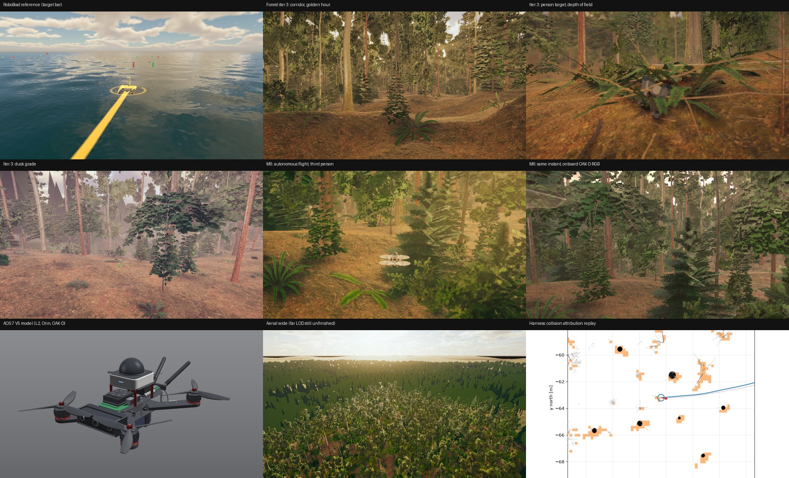

# CRANE drone simulator: visual gallery (as of 2026-11-10)

Everything here comes from the CRANE Unity simulator: Unity 6000.5.10f1 with HDRP 17.5, rendered through the Theater aerial director. All images are from seeded runs: forest seed 1337 unless noted, with TreeGen stand seed 7.

## What has been built visually

| Area | State | Images |
|---|---|---|
| **Procedural forest** (`Assets/Drones/Environment`) | **Iteration 1:** seeded scene with lighting presets and post-processing. **Iteration 2:** denser crowns, mid-story, root flares, layered ground, cloud presets, far landscape. **Iteration 3 (in progress):** fixes for far-terrain streaks, speckled crowns, target occlusion, grass and the dusk grade. | [`environment/`](../environment/) (iteration 1), [`iter2/`](../environment/iter2/), [`iter3/`](../environment/iter3/), with side-by-side comparisons in `iter3/compare/` |
| **AOS 7 V5 quad model** (`Assets/Drones/Models`) | Modelled to measured dimensions, with Unitree L2 dome, Orin heatsink, OAK-D S2 bar, antennas and F90 motors | [`model/`](../model/) (7 views) |
| **TreeGen** (our own space-colonisation and pipe-model grower) | v0.2: light-driven thickening, twig sprays, 25-variant library (beech, spruce, birch, snag, fallen log), Unity importer. The forest provider is opt-in. | [`treegen/`](../treegen/), [`treegen/previews_v02/`](../treegen/previews_v02/) |
| **Demo director** (`Assets/Scripts/Theater/Aerial`) | Cinematic and onboard camera profiles kept separate. 69 s six-shot sequence. Headless capture through the real aerial plant. | [`demo/smoke_orbit/stills/`](../demo/smoke_orbit/stills/) (smoke test of shot 5) |
| **Autonomous flight renders** (M6) | The lockstep C# autonomy flies the forest corridor. Third-person and onboard stills come from the same run at t = 6, 18 and 32 s. | [`autonomy_m6/`](../autonomy_m6/) |
| **Seeded, reproducible flight** | seed1337_run1: 100 OAK-D RGB and depth frames, state/IMU logs, plus a bit-identical repeat check (run1 vs run2: pose, attitude and velocity max difference 0.0) | [`flights/seed1337_run1/`](../flights/seed1337_run1/) |
| **Harness diagnostics** | Top-down collision-attribution replays: truth vs estimate, occupied belief voxels, struck twig | [`harness/`](../harness/) |
| **RoboBoat reference** | The visual bar we are aiming at: 8 stills plus a 13 s clip | [`reference/`](../reference/) |

## Honest status vs the RoboBoat bar
- **Ground level** (corridor, trail, clearing, golden/overcast): close to the target. It has plausible canopy light, ground litter, ferns and depth of field.
- **Aerial views are not there yet.** Beyond the near stand, the far terrain renders as a flat green band with dark triangular impostors (`iter3/09`, `10`). This is the main open iteration-3 item.
- **Dusk grade** (`iter3/06`): grey triangular silhouettes show in the background, the same far-LOD problem.
- **Person target** (`iter3/04`): under heavy occlusion it reads as a grey shape. A clothed, posed person model is still to do.
- **Not rendered yet** (Unity is paused while the modular pilot runs):
  - the full 69 s demo
  - the TreeGen-vs-built-in comparison
  - the two-drone decision-card demo

## Regenerating
- **Forest stills:** `BuildDroneForest` + the Theater rigs (see `../STATUS.md`).
- **Demo:** `Assets/Drones/Demo/Sequences/forest_demo_v1.json`.
- **Unity launch:** always through `~/.cache/research/fs-scripts/unity-drones --render LOG ...` (see `../RESUME.md`).
- **Overview sheet:** built from the files listed above with PIL; regenerate when iteration 3 lands.
