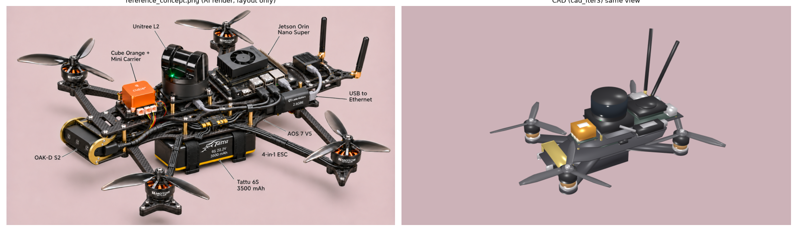
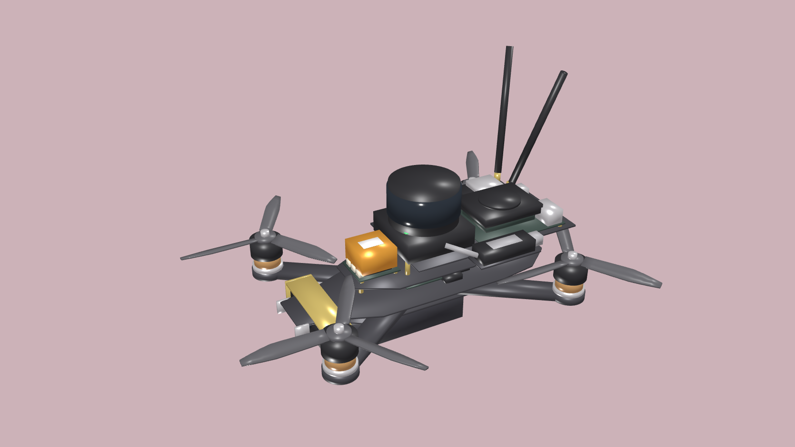
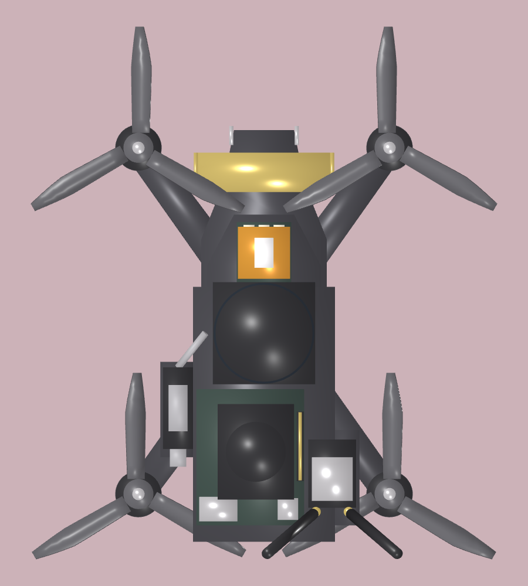
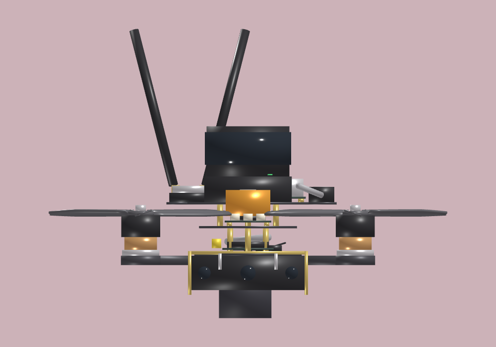
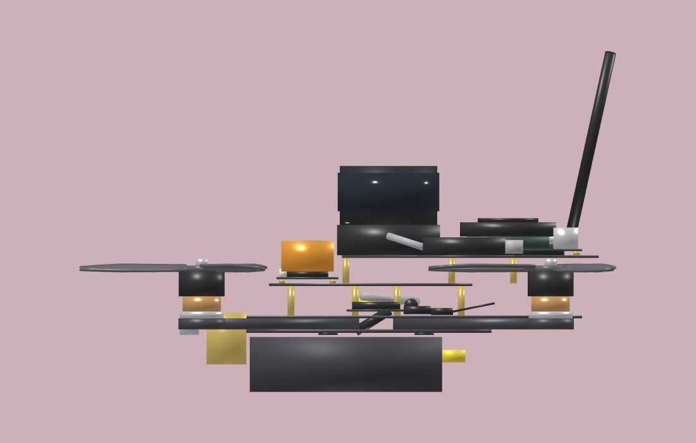
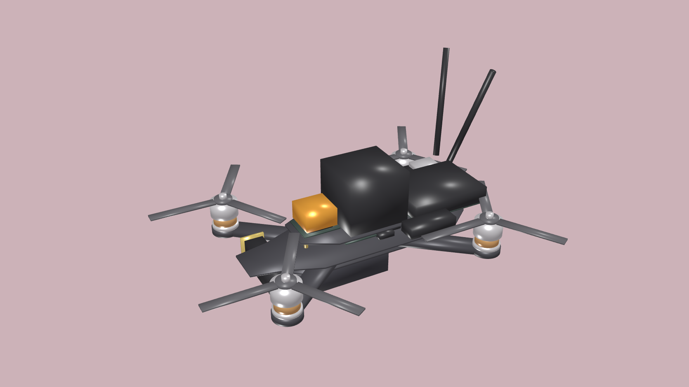
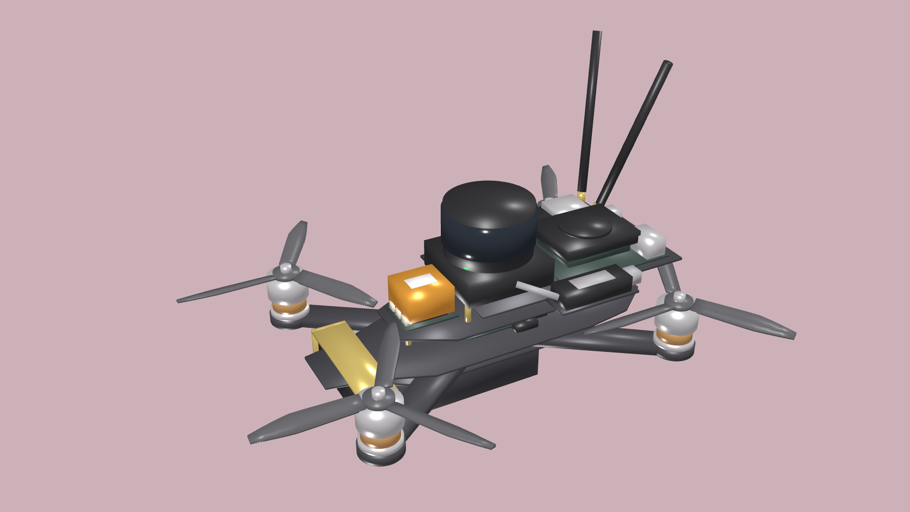

# AOS 7 V5 search drone: CAD model

The parametric CAD of the real build, made in a three-iteration concept-to-CAD loop against the reference layout (`reference_concept.png`).
- **Source:** `Tools/DroneCAD/aos7v5/`
- **URDF:** `Assets/Robot Descriptions/aos7v5/`
- **Downloads:** [`aos7v5.step`](aos7v5.step), [`aos7v5_cad.glb`](aos7v5_cad.glb), [`aos7v5_cad.obj`](aos7v5_cad.obj)

**Key numbers:**
- All-up mass 1.843 kg
- Stretched-X frame, 254 × 184 mm motor rectangle (313.6 mm diagonal)
- Two decks, with 4.2 mm minimum prop clearance
- Thrust-to-weight 4.8
- This is now CRANE's live `aos7_v5_f90_6s` profile; the previous one is kept as `_v1`

## Final model (iteration 3)

| Reference concept vs CAD (same view) |
|---|
|  |

| Iso | Top |
|---|---|
|  |  |

| Front | Side |
|---|---|
|  |  |

## How it got there

| Iteration 1 | Iteration 2 | Iteration 3 |
|---|---|---|
|  |  |  |
| Blocks on one deck. The rear electronics cut the prop discs; the automated clearance check failed. | Payload deck at 48 mm, tapered pitched props, exact interference test, battery moved to balance the CoM. | Detail and clash fixes: 0 interferences, all meshes watertight, all 59 checks pass. |

Each iteration's critique is in `cad_iterN/critique.md`.
