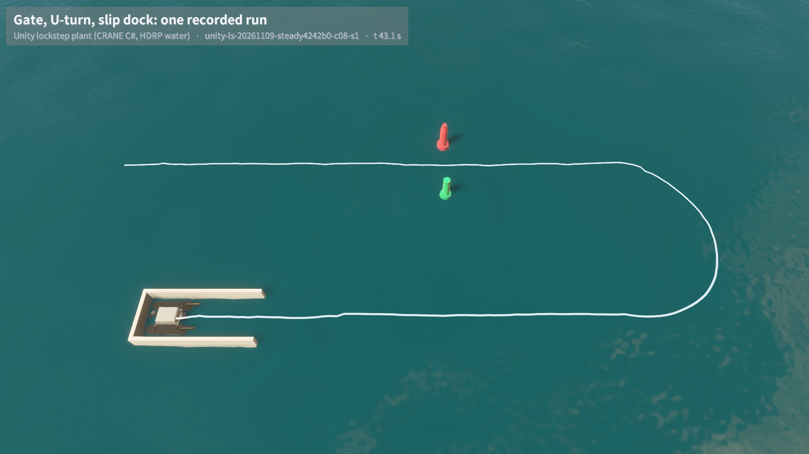
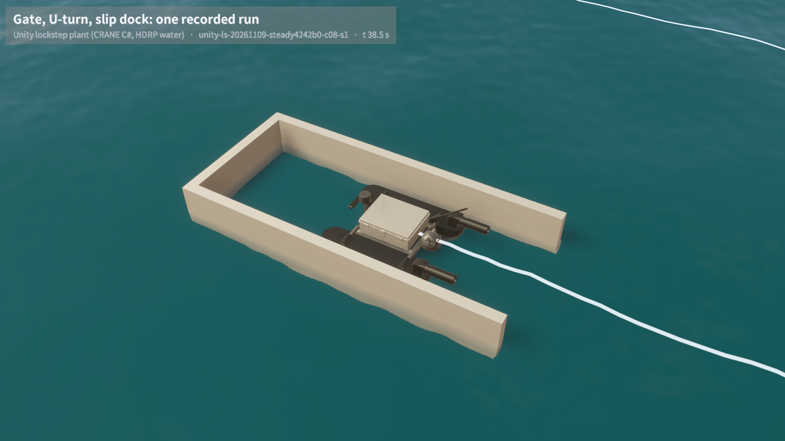
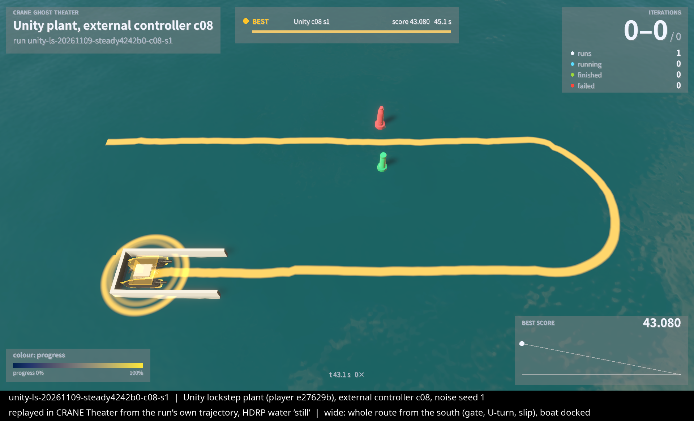
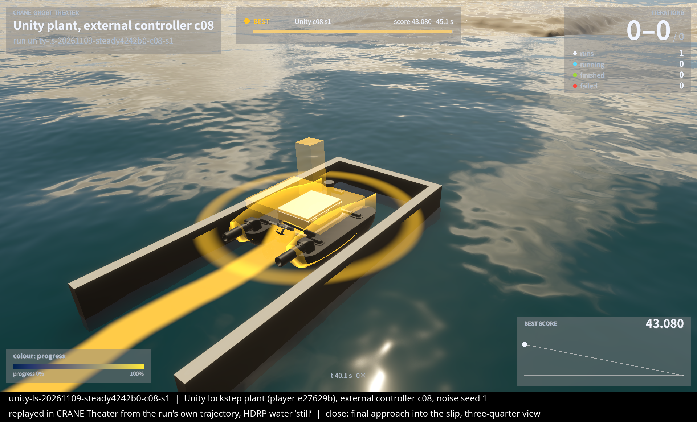
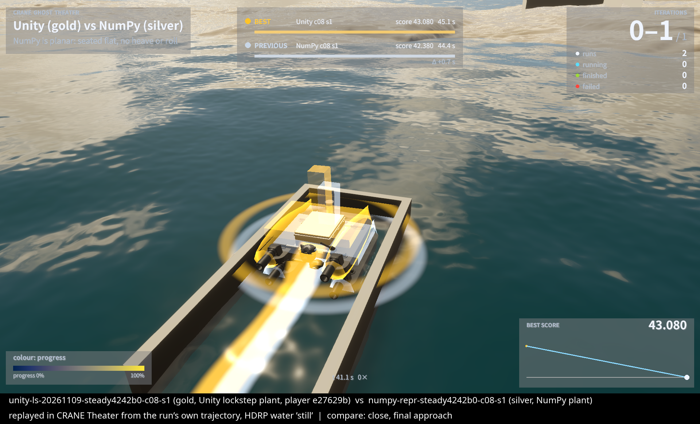

# Simulator screenshots (DecisionCal sprint)

All images are real renders of one recorded run, replayed in CRANE Theater (deterministic pose playback,
HDRP water). The Theater camera and look are separate from the simulated sensors. Run:
`unity-ls-20261109-steady4242b0-c08-s1` — Unity lockstep plant, steady boat, controller c08, seed 1; gate,
U-turn, slip dock; docked at 43.08 s with no contacts.

## Hour 12 (2026-11-10) — rebuilt demo player `8764855e`, minimal caption, untinted boat

Wide: whole route, gate buoys, trail, boat docked.

Close: boat half-way into the slip at t = 38.5 s.

## Hour 2 (2026-11-09) — first stills, old player `e27629b`, fleet HUD and gold hero tint

Two-layer overlay on the final approach: Unity (gold) against the NumPy plant flying the same controller
and seed (silver). NumPy is planar, so its boat sits flat.

## How these were made

`Tools/DecisionCal/demo/README.md` (capture → pack → render) and `Tools/DecisionCal/demo/player/BUILD.md`
(player build, lockstep check, `render_demo.py`). Known gaps: the plain look (flat water colour, blocky
dock); the `theater` look preset has not been rendered yet; relaunching the mission gives dock times
0.6–0.7 s from the reference because Unity runs are not repeatable after reset.
